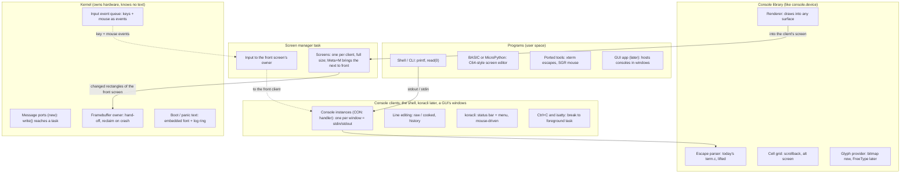

# Console and screen plan (handover)

Status: **steps 1 to 4 done** (step 3 as two PRs, 3a and 3b; step 4 as 4a
signals, 4b the screen manager, 4c the console handler and the shell on it,
4c2 in two PRs, 4c2a typing through the debug console and 4c2b the shell on
the display, in review). Sliding screens (4d) and step 5 (mouse, graphics)
are next. It is the outcome of a design discussion on
2026-11-12 and is the "terminal design" that `libc-plan.md` defers to koracli.
No milestone number has been assigned yet.

Diagram (Claude Whiteboard, private to the author unless shared):
https://claude.ai/artifact/QXgrsw5YDAKwu67d5rLjhX. The Mermaid block below
carries the same content, so the link is not needed to follow the plan.

Code references were read from `lazzelor/koraos-kernel` at `ee4225f`
(2026-11-11), and "Today" was brought up to date with steps 1 and 2. Check them
against the working tree before relying on them.

## Decision

Follow the AmigaOS split (`console.device` plus the `CON:` handler), not the
Linux one (kernel TTY, ptys) and not the old Windows one (console API in a
system process):

- The **kernel** owns the hardware and knows nothing about text, apart from a
  small boot and panic fallback.
- A reusable **console library** in user space holds the terminal: escape
  parser, cell grid, renderer, fonts.
- A **screen manager task** owns the screen and the input queue. Programs
  open full-size screens on it, Amiga style, and it sends the keys to the
  owner of the screen in front.
- **Console clients** open a screen and host the console instances that
  programs use as stdin and stdout (they are their `CON:` handlers): the
  shell first, koracli later, and a GUI's terminal windows.

No ptys. In this design the terminal is not a kernel object, so nothing needs
to pretend to be one.

## Why

- koracli needs a status bar, a menu, mouse input, drawing on the text screen
  and any font. That is too much policy for a kernel driver.
- An optional GUI (in the spirit of Windows on DOS or GEOS: an app, not part
  of the OS) must be able to host consoles in its own windows. A library that
  renders into any surface gives that for free.
- With no memory protection, a message is a pointer, so routing `write()` to a
  user task is cheap.

## Today

- The console library, `user/libconsole` (step 2): `term.c` + `term.h`, the
  xterm-compatible parser, cell grid, scrollback and alternate screen, and
  `term_render.c`, which draws a terminal into any surface with the embedded
  8x8 font (`font8x8.h`). The kernel builds it in for its screen terminal
  (`src/video/console_fb.c` is the glue); user programs link it from source
  (`condemo` runs two consoles in windows).
- `src/tty.c`: input ring of **bytes**, `tty_read` / `tty_write`, ONLCR and
  scrollback requests. Its readers are the input event queue's consumer while
  no screen manager claims it. Serial input is the debug console's only
  (4c2b).
- Standard handles (step 3b): each process has stdin, stdout and stderr
  handles, the kernel console, one of its files or a console handler's port,
  inherited at spawn or given by `spawn_std`. The libc reads them at startup
  and talks to a handler in packets. Raw fds 0, 1 and 2 still reach
  `tty_read` and `tty_write` in `src/sys/syscall.c`.
- Keys are events (step 1): `virtio_input.c` and `circle/circle_env.cpp` post
  a `struct input_event` (`include/input/event.h`) to the kernel queue in
  `src/input/input.c`. They still become bytes inside the kernel, in the
  temporary adapter `src/input/input_tty.c`, which the tasks reading the tty
  run. Serial input is bytes already and calls `tty_input_push`; so do the
  kernel terminal's status replies, through the host hook the library calls.
- Line editing is the console's (step 4c): `user/libconsole/edit.c` in the
  console on a screen, `user/libscreen/console.c`. `kgetline` is gone.
- Signals (step 4a): a thread waits on several sources at once, its ports,
  its children's ends and other threads (`sig_wait`). `condemo <program>`
  waits on its port and its program that way.
- The screen manager (steps 4b1 and 4b2): `screens` claims the display and
  the keyboard from the kernel, and programs open screens on it with
  `user/libscreen`. init runs `screens shell` (4c2b), and the shell runs on a
  console on a screen of its own; the kernel terminal shows the boot log
  until then, and comes back if the manager ends.
- The kernel log is UART-only (`kernel.c`). Programs can already draw straight
  into the framebuffer through `fb_info` (`gfxdemo`).

## Target

### Kernel

- **Input as structured events.** Key down/up with keycode, modifiers and
  Unicode value; mouse move, buttons, wheel. Turning these into bytes or
  escape sequences becomes the console's job.
- **Framebuffer ownership.** Hand the framebuffer to one user task; take it
  back when that task exits or crashes.
- **Message ports.** The one new primitive: a queue, a pointer and a wake-up.
  Reusable later for GUI events, a `PIPE:`-style handler and the ARexx-style
  named ports already mentioned in `libc-plan.md`.
- **Fallback text path.** Keep the embedded font and a minimal terminal for
  early boot and panics only. Write the boot log to a ring buffer as well as
  the UART, so the screen manager can show it as a log view.

### Console library

- `term.c` moved to user space, still building for the kernel fallback.
- Renders into a surface (pointer, width, height, pitch, clip rectangle)
  instead of "the screen".
- Fonts behind a glyph-provider interface: code point in, alpha mask and
  metrics out, cached. `term_cell_t.ch` is a `uint8_t` today and must widen
  to a code point.
- Can start as code linked statically into each program.

### Screen manager

- A small task of its own, as Intuition's screens on AmigaOS: it owns the
  framebuffer and the input queue and knows no text and no windows.
- **Screens.** A client opens a screen: a full-size pixel buffer in memory it
  can reach (there is no memory protection), which it draws into and whose
  changed rectangles it reports. The manager copies the front screen's changes
  to the framebuffer. Drawing to a buffer, not straight to the framebuffer, is
  what lets screens switch, later slide down to show the one behind as on the
  Amiga, and survive a client that crashes.
- **Meta+M** (the GUI key: Command on Apple keyboards, the Windows key on PC
  ones) brings the next screen to the front, as Left-Amiga+M did.
- **Input** goes to the owner of the front screen. Focus between the windows
  of one screen is the client's own business (a GUI's event manager).
- Several clients run at once, each full screen: the shell, a GUI, a game.

### Console clients

- A client opens a screen and hosts one or more console instances. A
  program's stdin and stdout are handles to an instance (like AmigaOS
  `pr_CIS` / `pr_COS`), not fixed fds. The first client is the shell itself
  (`user/shell.c`, converted in step 4c); koracli comes later, and a GUI's
  terminal windows are consoles too.
- Line editing and history live in the client, with a raw/cooked switch, so
  `kgetline` goes away (confirmed for step 4c). This also enables a
  C64-style screen editor: move the cursor anywhere, press Return, submit
  that line.
- Two interfaces to a console:
  1. Byte stream with xterm escapes, for `printf` and ported tools. Mouse
     through xterm SGR mouse mode (`ESC[?1006h`).
  2. Direct API for programs that link the library: pixels, redefinable
     glyphs, a graphics layer composited under the text layer.
- Tracks a foreground task: Ctrl+C sends it a break through the existing
  `kill`. `isatty` means "this handle is a console".
- The optional GUI takes the screen from the screen manager, and each of its
  terminal windows is another console instance.

## Steps (one PR each)

- [x] 1. Keyboard to an event queue. Keep the current byte path as a
      temporary adapter so nothing else changes.
- [x] 2. Lift `term.c` into a library that builds for kernel and user space.
- [x] 3. Message ports and handle-based stdin/stdout, as two PRs:
  - [x] 3a. Message ports.
  - [x] 3b. stdin, stdout and stderr as handles: the kernel console, a file
        or a console handler's port, inherited at spawn; the libc takes them
        at startup and gains `isatty`.
- [x] 4. Screen manager on top of the library, as three PRs:
  - [x] 4a. Signals: one thread waits on several ports, its children and
        other threads at once.
  - [x] 4b. The screen manager, as two PRs:
    - [x] 4b1. The kernel's part: the input queue claimed by a thread and
          signalling it, the screen handed over and taken back at the
          holder's end, a signal at any process's end, and the debug
          console's `keylog`.
    - [x] 4b2. The screen manager program: screens with changed rectangles,
          Meta+M, input to the front screen's owner, `condemo` on a screen of
          its own.
  - [x] 4c. The shell as the first console client, as two PRs:
    - [x] 4c1. The console handler: a console on a screen that serves its
          programs' packets, cooked and raw modes, line editing and history,
          Ctrl+C; `newcon` runs a program in one.
    - [x] 4c2a. The debug console types (`type`, `key`) and copies the
          consoles' text to the serial line (`conlog`); the smoke test drives
          the shell that way.
    - [x] 4c2b. The shell on a screen of its own, init starting `screens
          shell` with a display (no shell without one), Ctrl+C to the
          foreground program, `kgetline` gone; Ctrl-T and the shell on the
          serial line removed. The kernel terminal becomes the boot and panic
          fallback only.
  - Screens sliding down to show the one behind can follow, as 4d or later.
- [ ] 5. Mouse events, then the graphics layer.

## Step 1 as built

- **The event** is 16 bytes: type (key down or up), a repeat flag, the
  modifier state, the uptime in milliseconds, the key code and the Unicode
  character. The last 8 bytes are the payload; step 5 gives mouse events
  their own.
- **The key code is a USB HID usage** (Keyboard/Keypad page): the key's
  position, whatever the layout prints on it. The Pi's keyboard sends it as
  is; the VirtIO keyboard maps its evdev codes to it.
- **The character comes from the driver's layout**: the built-in US table on
  virt, Circle's keymap (`KORAOS_KEYMAP`, picked at build time) on the Pi.
  Ctrl, Alt and GUI never change it; they are in the modifier state, and what
  they mean is the consumer's business.
- **The queue** holds 256 events, is filled from interrupt handlers and
  drops, and counts, new events when it is full. It has one consumer, which
  provides `input_consumer_wake()`.
- **The adapter** is that consumer until step 4: a task reading the tty
  drains the queue into the byte ring, as the bytes and xterm sequences the
  VirtIO keyboard sent before. The Pi's keyboard now sends the same ones, so
  its arrows, Home, End, Insert, Delete and Ctrl+punctuation reach programs
  (they were dropped), and Alt+key types the key (it typed nothing). Step 4
  removes the adapter, the byte ring's keyboard half and
  `input_consumer_wake()` with it: the screen manager reads the events.

## Step 2 as built

- **One copy of the source, built twice.** `user/libconsole` sits beside
  libc and libk. The kernel compiles it with `KORAOS_KERNEL` defined, which
  makes `con_base.h` take the kernel's types and string functions; user
  programs get the libc's ISO headers. A program links the sources it needs
  (`cmake/userfs.cmake`), as the plan allowed: no shared library yet.
- **The host hooks.** A terminal asks its host for memory (`alloc`, never
  freed) and hands it the answers to status requests (`reply`), through
  `term_host_t`. The kernel's host gives frame pages and `tty_input_push`;
  `condemo`'s gives `malloc` and a buffer. The scrollback length is an
  argument of `term_init`.
- **Surfaces.** `term_render.c` is what `console_fb.c` drew with, made to
  draw a terminal anywhere on a surface (pixels, size, pitch, clip
  rectangle), partly off it or clipped by it. Several consoles can share a
  screen.
- **Left for the fonts feature**: the glyph provider and cells wider than a
  byte. The renderer still takes glyphs from the 8x8 font and `term_glyph()`.
- **Left for step 4**: the kernel terminal still serves programs; nothing in
  user space reads keys for a library console yet, so `condemo` only draws.

## Step 3a as built

- **Decisions** (2026-11-19): ports have ids, and optionally public names
  (`port_find`, as `AddPort`/`FindPort`); a message is a pointer to the
  sender's memory, as in Exec.
- **The kernel never touches a message.** It queues the address in a record
  of its own (128 in flight at most) and hands out the address, the kind
  (`PORT_MESSAGE`, `PORT_REPLY`, `PORT_RETURNED`) and the sender's pid. Ids
  carry a generation, so a stale id fails. Replies go to a port of the
  sender's own.
- **No memory protection, so the kernel guards lifetimes instead.** An ended
  program's ports are deleted and their queued messages returned; its queued
  messages are withdrawn; the messages it held are returned to their senders.
  A program whose messages a receiver still holds keeps its memory and slot
  ("draining") until the last one is replied.
- **Syscalls 48 to 54**: `port_create`, `port_delete`, `port_find`,
  `port_put`, `port_get`, `port_wait`, `port_reply` (`docs/syscalls.md`).
- **Not yet**: waiting on several ports at once, or on a port and the input
  queue together. The screen manager (step 4) will need one of them.

## Step 3b as built

- **Decisions** (2026-11-19): three standard handles per process (not fd
  slots), the libc speaking to handlers (not the kernel), and shell
  redirection in the same step.
- **Kernel**: `struct std_handle std[3]` in `struct process`; syscalls 55
  (`std_handles`) and 56 (`spawn_std`). Files are duplicated into the child
  (`fat32_dup`), ports are checked to exist.
- **libc**: `src/stdio/handle.c` asks once, on the first I/O; a file's stdout
  is fully buffered, a handler's streams send `struct con_packet`s on a reply
  port each; `isatty(0..2)`. The protocol is `<_libc/console.h>`.
- **libk**: `spawn_std`, `std_handles`; `kgetline` reads `stdin` and echoes
  on `stdout`, so no program uses a literal console fd any more (but
  `fpprobe` and `threadprobe`, which test the kernel).
- **Shell**: `< in`, `> out`, `>> out` (or glued: `>out`).
- **First console handler**: `condemo <program> [args]` runs the program
  with stdout and stderr in a library console window. It polls the program's
  end (`waitpid` with `WNOHANG`) between packets: there is no way yet to wait
  for a message and a child at once. It serves no reads.

## Step 4 decisions (2026-11-20)

- **The screen manager is not koracli.** It is a task of its own that owns
  screens, Amiga style; the CLI, a GUI and other full-screen programs are its
  clients and run side by side.
- **The first console client is the shell** (`user/shell.c`), converted to
  open a screen and serve its programs' consoles. koracli is later work.
- **Meta+M** switches screens.
- **Signals, as in Exec**, are how a server waits on several sources, rather
  than one port per server that every source posts to.

## Step 4a as built

- **Signals** (`src/proc/task.c`, `include/proc/task.h`): 32 bits per
  thread, of which 8 to 31 are allocated with `sig_alloc` and 0 to 7 are kept
  for the system. `sig_wait(mask)` sleeps until one is set and returns and
  clears those; `sig_set` looks and changes; `sig_send` sets another thread's.
  The bits are under the scheduler's lock, so an interrupt handler may
  signal: 4b's input can.
- **Sources**: `port_signal(port, bit)` ties a port to a bit, set by every
  arrival (at once if a message waits). `SPAWN_SIGNAL(bit)` sets one when the
  child ends. `sig_free` unties the ports of a bit.
- **Syscalls 57 to 62** (`docs/syscalls.md`).
- **`condemo <program>`** waits on its port and its program's end with one
  `sig_wait`; its 5 ms poll is gone.
- **Not yet**: the input queue setting a signal. It has one consumer, the
  kernel's tty adapter, until the screen manager takes it over in 4b.

## Step 4b decisions (2026-11-21)

- **Two PRs**: 4b1 for the kernel, 4b2 for the screen manager program.
- **No kernel console screen.** Until 4c makes the shell a client, the
  manager does not show the kernel terminal as one of its screens: it is
  started from the shell with the programs it hosts, the shell waits for it,
  and it gives the screen and the keyboard back when it ends (or the kernel
  takes them back if it crashes).
- **Clients' ends**: a new syscall sets a signal when any process ends, so the
  manager closes a crashed client's screen at once.
- **`keylog on|off`** in the debug console traces each key event, xev style:
  the device that sent it, who took it and, for a screen manager, the process
  it says the events go on to (the front screen's owner).

## Step 4b1 as built

- **The input queue's claim** (`src/input/input.c`, syscalls 64 to 66): a
  thread takes the events with `input_claim(bit)`; each queued event then
  sets its signal, from the keyboard's interrupt, instead of waking the tty's
  readers, and `input_read` takes up to 32 without sleeping. Events waiting at
  the claim are the claimer's. The claim goes back to the tty adapter when the
  thread gives it up, frees the bit or ends; the adapter takes what is left.
  `input_focus(pid)` names the front screen's owner, for `keylog` only.
- **Event sources**: drivers register a name (`virtio-keyboard`,
  `usb-keyboard`) and stamp its number in the event's former reserved byte.
- **The screen** (`src/video/console_fb.c`, syscall 67): `fb_claim(1)` stops
  the kernel terminal drawing; it keeps taking text. `fb_claim(0)` or the
  holder's end gives the screen back, and the terminal redraws all of it.
- **`sig_on_end(pid, bit)`** (syscall 63): a signal at any process's end,
  from a table of 64 watches, stopped by `-1`, `sig_free` or the watcher's
  end.
- **`keylog [on|off]`** (`src/input/keylog.c`): each event taken is noted
  under the locks that take it and printed later with no spinlock held (by
  the tty's reader or `input_read`), with the queue's drops and any notes
  lost.
- **Not yet**: the manager itself, its protocol and Meta+M (4b2). The kernel
  gives events no meaning; Meta+M will be the manager's.

## Step 4b2 decisions (2026-11-21)

- **Programs open their screens**, as Intuition's `OpenScreen()`: they find
  the manager's public port `screens`. `screens prog [args] + prog [args]`
  starts the manager with its first programs and ends when the last screen
  has closed and they have ended. A program that finds no manager draws on
  the framebuffer as before.
- **The client side is a library**, `user/libscreen`, beside libconsole.
- **The manager allocates the screens**, in its own memory: a crashed
  client's pages are reclaimed, its screen stays valid until it is closed.
  (Revised after 4c2b: the program allocates its pixels, below.)

## Step 4b2 as built

- **`screens`** (`user/screens.c`): starts its programs (`+` between them)
  and serves requests on its port:
  open, damage (a rectangle copied to the display if the screen is in front),
  to front, close. A new screen comes to front. A screen closes when its
  program closes it or ends (`sig_on_end`; its end is found by watching again,
  which fails for a program gone). It reports on its stdout, the kernel
  console, shown once it has ended.
- **The display and the keyboard are held only while a screen is open.** With
  none, the console has them back, so a program that opens no screen (a
  shell started by `screens`, say) still gets its keys: it cannot be left
  waiting for keys nobody passes on.
- **Keys**: Meta+M brings the next screen to front, its M and the M's key up
  swallowed; every other event goes to the front screen's program, into its
  screen's ring of 64 events, and signals the thread that opened it.
- **`user/libscreen`**: `screen_open`, `screen_damage`, `screen_event`,
  `screen_signal`, `screen_to_front`, `screen_close`. Requests are messages
  on the manager's port, each waiting for its reply, so damage is copied when
  `screen_damage` returns.
- **`gettid()`** (syscall 68): the thread a screen's events signal.
- **`condemo` and `gfxdemo`** open a screen when a manager runs, and keep it
  until Escape.
- **Not yet**: screens of other sizes or depths, sliding screens (4d), a
  manager that survives its own crash (the clients' pixels are its memory),
  and the shell as a client (4c).

## Step 4c decisions (2026-11-22)

- **Line editing and history live in the console**, with cooked and raw
  modes; `kgetline` goes away.
- **The serial line stays separate.** A shell on a screen takes only keys.
  (Revised for 4c2, below.)
- **init starts `screens shell`** when there is a display.
- **Ctrl+C kills** the foreground program.
- **Two PRs**: 4c1 the console handler, 4c2 the shell on it.

## Step 4c1 as built

- **`user/libconsole/keys.c`**: key events to the bytes xterm sends
  (arrows, Home, End, Delete, Ctrl codes, UTF-8), pure like `term.c`.
- **`user/libconsole/edit.c`**: the line editor, pure and host-tested
  through a real terminal. Cooked: echo, Left/Right, Home/End (Ctrl+A/E),
  Backspace/Delete, Ctrl+U/K, Up/Down through 32 lines of history, Ctrl+D on
  an empty line as the end of input, one line per read. Raw: bytes as typed,
  no echo. Ctrl+C is a break in both. The echo keeps the terminal's cursor
  where the editor counts it, wrapped lines included (rows by CSI A/B, the
  column by CSI G).
- **`user/libscreen/console.c`**: a console on a screen. It serves its
  programs' packets (`CON_WRITE`, `CON_READ`, and the new `CON_MODE`), holds
  reads until a line or a key is there, answers the reads of programs that
  ended (`sig_on_end`), scrolls back with Shift+PageUp/PageDown, and copies
  only the rows that changed.
- **`console_mode(CON_RAW)`** in libk (`__con_mode` in the libc) switches a
  program's console.
- **`newcon program`** runs a program in a console on a screen of its own;
  Ctrl+C kills it. `cat` with no path copies stdin when it can end (a console
  window, where Ctrl+D ends it, or a file), so `screens newcon cat` echoes
  lines; on the kernel console, which has no end of input, it prints its
  usage.
- **Not yet**: the shell on it, init, and `kgetline`'s removal (4c2).
  Program output that arrives while a line is half typed is not redrawn
  around it.

## Step 4c2 decisions (2026-11-22)

- **The shell is on the display only, the serial line is the debug console
  only**, on QEMU as on a Pi: the shell on the serial line was a stopgap
  from before USB keyboards. Ctrl-T goes.
- **No display, no shell**: the debug console alone.
- **The smoke test types through the debug console**: `type TEXT` and `key
  NAME` post key events, and `conlog on` copies what the consoles show to
  the serial line. It works on a Pi too, and on QEMU raspi4b, which has no
  keyboard.
- **Two PRs**: 4c2a the debug console's typing and the harness on it, with
  the shell still on the kernel console; 4c2b the shell moved.

## Step 4c2a as built

- **`type TEXT`** (`src/console.c`, `src/input/typing.c`): each character
  as its key on a US keyboard (Shift and Ctrl as needed), posted to the input
  queue as a keyboard's down and up events from the source `debug-console`.
  Escapes: `\n` (Enter), `\t`, `\e`, `\s`, `\\`, `\xHH`. **`key NAME...`**
  presses keys by QEMU's sendkey names (`ret`, `up`, `ctrl-c`, `meta_l-m`).
  Both report events the queue dropped.
- **`conlog [on|off]`**: the kernel console copies its output to the serial
  line (it did that under QEMU unconditionally), user consoles copy theirs
  through the new `conlog` syscall (69): programs' writes and the lines
  entered, not the echo's cursor moves. With it on the debug console neither
  echoes nor prompts. On by default under QEMU, where the serial line is now
  the debug console from boot.
- **The smoke test** types every command with `type` (in chunks of 32
  characters) and sends debug console commands without Ctrl-T; a step drives
  two screens with `key` (a key to the front, Meta+M, a probe ending with its
  screen open), on every graphics profile.

## Step 4c2b as built

- **The shell hosts its console.** Started on the kernel console (init runs
  `screens shell`), `shell` opens a screen and a console on it and runs
  itself there with `console_run`, as AmigaOS's NewShell opens a `CON:`
  window: the first shell serves the console, the second reads commands with
  `fgets`. Started on a console already (`shell` typed in one) or with a
  file for stdin, it reads at once. With no screen manager it says to start
  one. The end of input (Ctrl+D) ends it like `exit`.
- **Ctrl+C is a signal.** `console_run` kills its program on Ctrl+C
  (newcon), or sends it `SIG_BREAK`, system bit 0, as `CON:` sends
  `SIGBREAKF_CTRL_C`; the shell waits for its foreground program with
  `sig_wait` on that bit and the program's end, and kills it on a break. A
  break at the prompt drops the line and is cleared before the next program.
- **init**: with a display, `screens shell`, started again when it ends
  (unless within a second); without one, no shell.
- **Lending.** A program borrows the display and the keyboard from the
  manager (`screens_borrow`, `screens_return`): the manager gives them back
  to the kernel console until the program returns them or ends, then takes
  them back and shows its front screen. No screen opens meanwhile.
  `inputprobe` borrows them, so it still checks the kernel's claims.
- **Programs on screens.** `jobdemo` draws on a screen of its own (Enter or
  Escape closes it), like `gfxdemo` and `condemo`. A screen's event ring
  holds 256 events, room for a line typed at once.
- **The kernel**: the serial line is the debug console only, no Ctrl-T.
  `kgetline` is gone from libk.
- **The smoke test** drives the shell on its screen; without a display it
  checks that there is no shell and runs the debug console's checks. CI's
  EL2 profiles run with a display, so they keep the shell.
- **Not yet**: Ctrl+C at the prompt does not print a new prompt (the
  console drops the line, the shell keeps waiting for one); keys typed while
  the display is lent wait for the manager. A crashed manager leaves the
  shell running with nothing on the display, drawing into pixels that were
  the manager's memory. (init does start the shell again: `screens` is its
  child. Both are fixed next.)

## Screens that survive a crash, as built (after 4c2b)

Without memory protection, neither side of a screen may write into the
other's memory: a crash frees the crashed side's pages, and the other side
would write into pages that may belong to another program by then.

- **The pixels are the program's.** `screen_open` allocates them (as large
  as the display, from `fb_info`) and gives them in `SCREEN_OPEN`; the manager
  only reads them. A crashed client costs at worst a moment of garbage on the
  display, never a write into freed memory.
- **Keys are messages**, `struct screen_events` (up to 32 events) in the
  manager's memory, sent to the screen's own port and replied by the
  program: one out at a time, the rest waiting in the manager (256, then
  dropped and counted). Ports keep an ended sender's memory until its
  messages are replied, so a crashed manager's events stay readable; a
  crashed client's messages come back, and so does a closed screen's.
- **Clients notice the manager's end**: `SCREEN_OPEN`'s reply names the
  manager's pid (a reply's sender is the requester), which the program
  watches on the screen's signal (`sig_on_end`). `screen_gone` says so;
  requests stop. `console_run` kills its program then, so the shell's console
  ends the shell and itself; gfxdemo, condemo, jobdemo and screenprobe end.
- **init** gives up only after three quick ends in a row, not one: someone
  may exit a new shell within a second.
- **The smoke test** kills `screens` from the shell, with gfxdemo running:
  the old shell and gfxdemo end, and init starts a new shell.

## Safety net

If the screen manager crashes, the screen is lost. The kernel reclaims the
framebuffer and draws with its own font; the UART debug console stays as it
is today.

## Open decisions

- Font format for the first glyph provider (PSF2 or BDF), and whether
  FreeType is added at all.
- How the library is shared once static linking is not enough.
- Whether boot text stays on screen in the long run or only the log ring.
- Milestone number. `roadmap.md` has an unnumbered section and
  `features.yaml` has the entries, as planned features without a milestone.
- Where the keyboard layout lives. Today each driver has its own (see "Step 1
  as built"). The aim is layouts as data files that a user command loads, in
  the manner of DOS's `KEYB` and `KEYBOARD.SYS`, with one translator for
  every keyboard. Because an event always carries the key's position and the
  modifiers, the translation can move without changing the event. What is
  open is who holds the active table: the kernel's input layer, which keeps
  the event's character right for every consumer and for the boot and panic
  fallback, or the console library, as AmigaOS does with `keymap.library`.
  Dead keys and compose sequences are stateful and belong to the console
  either way.
- What Alt does in a console. The event reports it; the step 1 adapter
  ignores it. The xterm convention is to send ESC before the key.
