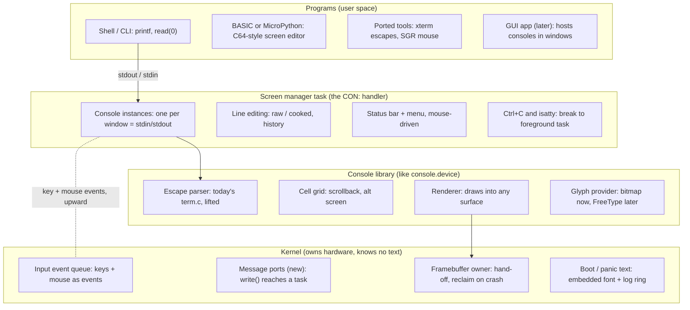

# Console and screen plan (handover)

Status: **proposal, not started.** It is the outcome of a design discussion on
2026-11-12 and is the "terminal design" that `libc-plan.md` defers to koracli.
Nothing here is implemented, and no milestone number has been assigned yet.

Diagram (Claude Whiteboard, private to the author unless shared):
https://claude.ai/artifact/QXgrsw5YDAKwu67d5rLjhX. The Mermaid block below
carries the same content, so the link is not needed to follow the plan.

Code references were read from `lazzelor/koraos-kernel` at `ee4225f`
(2026-11-11). Check them against the working tree before relying on them.

## Decision

Follow the AmigaOS split (`console.device` plus the `CON:` handler), not the
Linux one (kernel TTY, ptys) and not the old Windows one (console API in a
system process):

- The **kernel** owns the hardware and knows nothing about text, apart from a
  small boot and panic fallback.
- A reusable **console library** in user space holds the terminal: escape
  parser, cell grid, renderer, fonts.
- A **screen manager task** owns the screen and the input queue, and hosts
  console instances that programs use as stdin and stdout.

No ptys. In this design the terminal is not a kernel object, so nothing needs
to pretend to be one.

## Why

- koracli needs a status bar, a menu, mouse input, drawing on the text screen
  and any font. That is too much policy for a kernel driver.
- An optional GUI (in the spirit of Windows on DOS or GEOS: an app, not part
  of the OS) must be able to host consoles in its own windows. A library that
  renders into any surface gives that for free.
- With no memory protection, a message is a pointer, so routing `write()` to a
  user task is cheap.

## Today

- `src/video/term.c` + `include/video/term.h`: xterm-compatible parser, cell
  grid, scrollback, alternate screen. Already pixel-free; `console_fb.c` is
  the renderer, with the embedded 8x8 font (`font8x8.h`).
- `src/tty.c`: input ring of **bytes**, `tty_read` / `tty_write`, ONLCR, the
  serial route switch (Ctrl-T) and scrollback requests.
- `src/sys/syscall.c`: fd 0 is hard-wired to `tty_read`, fd 1 and 2 to
  `tty_write`. Other fds are FAT32 files.
- Keys become bytes inside the kernel: `virtio_input.c` and
  `circle/circle_env.cpp` call `tty_input_push`. Terminal status replies take
  the same path (`term.c`).
- Line editing is in user space: `kgetline` in `user/libk/koraos.h`.
- The kernel log is UART-only (`kernel.c`). Programs can already draw straight
  into the framebuffer through `fb_info` (`gfxdemo`).

## Target

### Kernel

- **Input as structured events.** Key down/up with keycode, modifiers and
  Unicode value; mouse move, buttons, wheel. Turning these into bytes or
  escape sequences becomes the console's job.
- **Framebuffer ownership.** Hand the framebuffer to one user task; take it
  back when that task exits or crashes.
- **Message ports.** The one new primitive: a queue, a pointer and a wake-up.
  Reusable later for GUI events, a `PIPE:`-style handler and the ARexx-style
  named ports already mentioned in `libc-plan.md`.
- **Fallback text path.** Keep the embedded font and a minimal terminal for
  early boot and panics only. Write the boot log to a ring buffer as well as
  the UART, so the screen manager can show it as a log view.

### Console library

- `term.c` moved to user space, still building for the kernel fallback.
- Renders into a surface (pointer, width, height, pitch, clip rectangle)
  instead of "the screen".
- Fonts behind a glyph-provider interface: code point in, alpha mask and
  metrics out, cached. `term_cell_t.ch` is a `uint8_t` today and must widen
  to a code point.
- Can start as code linked statically into each program.

### Screen manager

- Owns the screen and the input queue; draws the status bar and the menu.
- Hosts one or more console instances. A program's stdin and stdout are
  handles to an instance (like AmigaOS `pr_CIS` / `pr_COS`), not fixed fds.
- Line editing and history live here, with a raw/cooked switch, so `kgetline`
  goes away. This also enables a C64-style screen editor: move the cursor
  anywhere, press Return, submit that line.
- Two interfaces to a console:
  1. Byte stream with xterm escapes, for `printf` and ported tools. Mouse
     through xterm SGR mouse mode (`ESC[?1006h`).
  2. Direct API for programs that link the library: pixels, redefinable
     glyphs, a graphics layer composited under the text layer.
- Tracks a foreground task: Ctrl+C sends it a break through the existing
  `kill`. `isatty` means "this handle is a console".
- The optional GUI takes the screen from the screen manager, and each of its
  terminal windows is another console instance.

## Steps (one PR each)

- [ ] 1. Keyboard to an event queue. Keep the current byte path as a
      temporary adapter so nothing else changes.
- [ ] 2. Lift `term.c` into a library that builds for kernel and user space.
- [ ] 3. Message ports and handle-based stdin/stdout.
- [ ] 4. Screen manager on top of the library. The kernel terminal becomes
      the boot and panic fallback only.
- [ ] 5. Mouse events, then the graphics layer.

## Safety net

If the screen manager crashes, the screen is lost. The kernel reclaims the
framebuffer and draws with its own font; the UART debug console stays as it
is today.

## Open decisions

- Font format for the first glyph provider (PSF2 or BDF), and whether
  FreeType is added at all.
- Whether the screen manager **is** koracli or a separate task underneath it.
- Port API: names, anonymous versus named ports, message ownership.
- How the library is shared once static linking is not enough.
- What happens to stderr (fd 2): same console, or its own stream.
- Whether boot text stays on screen in the long run or only the log ring.
- Milestone number. `roadmap.md` has an unnumbered section and
  `features.yaml` has the entries, as planned features without a milestone.
