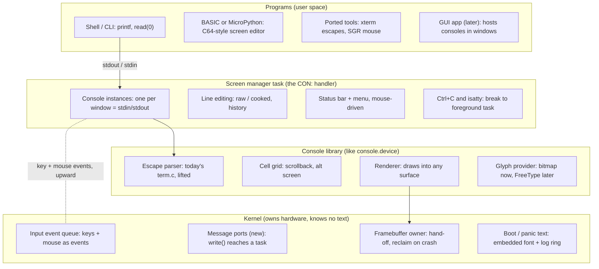

# Console and screen plan (handover)

Status: **steps 1 to 3 done** (step 3 as two PRs, 3a and 3b). It is the outcome of a design discussion on
2026-11-12 and is the "terminal design" that `libc-plan.md` defers to koracli.
No milestone number has been assigned yet.

Diagram (Claude Whiteboard, private to the author unless shared):
https://claude.ai/artifact/QXgrsw5YDAKwu67d5rLjhX. The Mermaid block below
carries the same content, so the link is not needed to follow the plan.

Code references were read from `lazzelor/koraos-kernel` at `ee4225f`
(2026-11-11), and "Today" was brought up to date with steps 1 and 2. Check them
against the working tree before relying on them.

## Decision

Follow the AmigaOS split (`console.device` plus the `CON:` handler), not the
Linux one (kernel TTY, ptys) and not the old Windows one (console API in a
system process):

- The **kernel** owns the hardware and knows nothing about text, apart from a
  small boot and panic fallback.
- A reusable **console library** in user space holds the terminal: escape
  parser, cell grid, renderer, fonts.
- A **screen manager task** owns the screen and the input queue, and hosts
  console instances that programs use as stdin and stdout.

No ptys. In this design the terminal is not a kernel object, so nothing needs
to pretend to be one.

## Why

- koracli needs a status bar, a menu, mouse input, drawing on the text screen
  and any font. That is too much policy for a kernel driver.
- An optional GUI (in the spirit of Windows on DOS or GEOS: an app, not part
  of the OS) must be able to host consoles in its own windows. A library that
  renders into any surface gives that for free.
- With no memory protection, a message is a pointer, so routing `write()` to a
  user task is cheap.

## Today

- The console library, `user/libconsole` (step 2): `term.c` + `term.h`, the
  xterm-compatible parser, cell grid, scrollback and alternate screen, and
  `term_render.c`, which draws a terminal into any surface with the embedded
  8x8 font (`font8x8.h`). The kernel builds it in for its screen terminal
  (`src/video/console_fb.c` is the glue); user programs link it from source
  (`condemo` runs two consoles in windows).
- `src/tty.c`: input ring of **bytes**, `tty_read` / `tty_write`, ONLCR, the
  serial route switch (Ctrl-T) and scrollback requests. Its readers are the
  one consumer of the input event queue, for now.
- Standard handles (step 3b): each process has stdin, stdout and stderr
  handles, the kernel console, one of its files or a console handler's port,
  inherited at spawn or given by `spawn_std`. The libc reads them at startup
  and talks to a handler in packets. Raw fds 0, 1 and 2 still reach
  `tty_read` and `tty_write` in `src/sys/syscall.c`.
- Keys are events (step 1): `virtio_input.c` and `circle/circle_env.cpp` post
  a `struct input_event` (`include/input/event.h`) to the kernel queue in
  `src/input/input.c`. They still become bytes inside the kernel, in the
  temporary adapter `src/input/input_tty.c`, which the tasks reading the tty
  run. Serial input is bytes already and calls `tty_input_push`; so do the
  kernel terminal's status replies, through the host hook the library calls.
- Line editing is in user space: `kgetline` in `user/libk/koraos.h`, on
  `stdin` and `stdout`.
- The kernel log is UART-only (`kernel.c`). Programs can already draw straight
  into the framebuffer through `fb_info` (`gfxdemo`).

## Target

### Kernel

- **Input as structured events.** Key down/up with keycode, modifiers and
  Unicode value; mouse move, buttons, wheel. Turning these into bytes or
  escape sequences becomes the console's job.
- **Framebuffer ownership.** Hand the framebuffer to one user task; take it
  back when that task exits or crashes.
- **Message ports.** The one new primitive: a queue, a pointer and a wake-up.
  Reusable later for GUI events, a `PIPE:`-style handler and the ARexx-style
  named ports already mentioned in `libc-plan.md`.
- **Fallback text path.** Keep the embedded font and a minimal terminal for
  early boot and panics only. Write the boot log to a ring buffer as well as
  the UART, so the screen manager can show it as a log view.

### Console library

- `term.c` moved to user space, still building for the kernel fallback.
- Renders into a surface (pointer, width, height, pitch, clip rectangle)
  instead of "the screen".
- Fonts behind a glyph-provider interface: code point in, alpha mask and
  metrics out, cached. `term_cell_t.ch` is a `uint8_t` today and must widen
  to a code point.
- Can start as code linked statically into each program.

### Screen manager

- Owns the screen and the input queue; draws the status bar and the menu.
- Hosts one or more console instances. A program's stdin and stdout are
  handles to an instance (like AmigaOS `pr_CIS` / `pr_COS`), not fixed fds.
- Line editing and history live here, with a raw/cooked switch, so `kgetline`
  goes away. This also enables a C64-style screen editor: move the cursor
  anywhere, press Return, submit that line.
- Two interfaces to a console:
  1. Byte stream with xterm escapes, for `printf` and ported tools. Mouse
     through xterm SGR mouse mode (`ESC[?1006h`).
  2. Direct API for programs that link the library: pixels, redefinable
     glyphs, a graphics layer composited under the text layer.
- Tracks a foreground task: Ctrl+C sends it a break through the existing
  `kill`. `isatty` means "this handle is a console".
- The optional GUI takes the screen from the screen manager, and each of its
  terminal windows is another console instance.

## Steps (one PR each)

- [x] 1. Keyboard to an event queue. Keep the current byte path as a
      temporary adapter so nothing else changes.
- [x] 2. Lift `term.c` into a library that builds for kernel and user space.
- [x] 3. Message ports and handle-based stdin/stdout, as two PRs:
  - [x] 3a. Message ports.
  - [x] 3b. stdin, stdout and stderr as handles: the kernel console, a file
        or a console handler's port, inherited at spawn; the libc takes them
        at startup and gains `isatty`.
- [ ] 4. Screen manager on top of the library. The kernel terminal becomes
      the boot and panic fallback only.
- [ ] 5. Mouse events, then the graphics layer.

## Step 1 as built

- **The event** is 16 bytes: type (key down or up), a repeat flag, the
  modifier state, the uptime in milliseconds, the key code and the Unicode
  character. The last 8 bytes are the payload; step 5 gives mouse events
  their own.
- **The key code is a USB HID usage** (Keyboard/Keypad page): the key's
  position, whatever the layout prints on it. The Pi's keyboard sends it as
  is; the VirtIO keyboard maps its evdev codes to it.
- **The character comes from the driver's layout**: the built-in US table on
  virt, Circle's keymap (`KORAOS_KEYMAP`, picked at build time) on the Pi.
  Ctrl, Alt and GUI never change it; they are in the modifier state, and what
  they mean is the consumer's business.
- **The queue** holds 256 events, is filled from interrupt handlers and
  drops, and counts, new events when it is full. It has one consumer, which
  provides `input_consumer_wake()`.
- **The adapter** is that consumer until step 4: a task reading the tty
  drains the queue into the byte ring, as the bytes and xterm sequences the
  VirtIO keyboard sent before. The Pi's keyboard now sends the same ones, so
  its arrows, Home, End, Insert, Delete and Ctrl+punctuation reach programs
  (they were dropped), and Alt+key types the key (it typed nothing). Step 4
  removes the adapter, the byte ring's keyboard half and
  `input_consumer_wake()` with it: the screen manager reads the events.

## Step 2 as built

- **One copy of the source, built twice.** `user/libconsole` sits beside
  libc and libk. The kernel compiles it with `KORAOS_KERNEL` defined, which
  makes `con_base.h` take the kernel's types and string functions; user
  programs get the libc's ISO headers. A program links the sources it needs
  (`cmake/userfs.cmake`), as the plan allowed: no shared library yet.
- **The host hooks.** A terminal asks its host for memory (`alloc`, never
  freed) and hands it the answers to status requests (`reply`), through
  `term_host_t`. The kernel's host gives frame pages and `tty_input_push`;
  `condemo`'s gives `malloc` and a buffer. The scrollback length is an
  argument of `term_init`.
- **Surfaces.** `term_render.c` is what `console_fb.c` drew with, made to
  draw a terminal anywhere on a surface (pixels, size, pitch, clip
  rectangle), partly off it or clipped by it. Several consoles can share a
  screen.
- **Left for the fonts feature**: the glyph provider and cells wider than a
  byte. The renderer still takes glyphs from the 8x8 font and `term_glyph()`.
- **Left for step 4**: the kernel terminal still serves programs; nothing in
  user space reads keys for a library console yet, so `condemo` only draws.

## Step 3a as built

- **Decisions** (2026-11-19): ports have ids, and optionally public names
  (`port_find`, as `AddPort`/`FindPort`); a message is a pointer to the
  sender's memory, as in Exec.
- **The kernel never touches a message.** It queues the address in a record
  of its own (128 in flight at most) and hands out the address, the kind
  (`PORT_MESSAGE`, `PORT_REPLY`, `PORT_RETURNED`) and the sender's pid. Ids
  carry a generation, so a stale id fails. Replies go to a port of the
  sender's own.
- **No memory protection, so the kernel guards lifetimes instead.** An ended
  program's ports are deleted and their queued messages returned; its queued
  messages are withdrawn; the messages it held are returned to their senders.
  A program whose messages a receiver still holds keeps its memory and slot
  ("draining") until the last one is replied.
- **Syscalls 48 to 54**: `port_create`, `port_delete`, `port_find`,
  `port_put`, `port_get`, `port_wait`, `port_reply` (`docs/syscalls.md`).
- **Not yet**: waiting on several ports at once, or on a port and the input
  queue together. The screen manager (step 4) will need one of them.

## Step 3b as built

- **Decisions** (2026-11-19): three standard handles per process (not fd
  slots), the libc speaking to handlers (not the kernel), and shell
  redirection in the same step.
- **Kernel**: `struct std_handle std[3]` in `struct process`; syscalls 55
  (`std_handles`) and 56 (`spawn_std`). Files are duplicated into the child
  (`fat32_dup`), ports are checked to exist.
- **libc**: `src/stdio/handle.c` asks once, on the first I/O; a file's stdout
  is fully buffered, a handler's streams send `struct con_packet`s on a reply
  port each; `isatty(0..2)`. The protocol is `<_libc/console.h>`.
- **libk**: `spawn_std`, `std_handles`; `kgetline` reads `stdin` and echoes
  on `stdout`, so no program uses a literal console fd any more (but
  `fpprobe` and `threadprobe`, which test the kernel).
- **Shell**: `< in`, `> out`, `>> out` (or glued: `>out`).
- **First console handler**: `condemo <program> [args]` runs the program
  with stdout and stderr in a library console window. It polls the program's
  end (`waitpid` with `WNOHANG`) between packets: there is no way yet to wait
  for a message and a child at once. It serves no reads.

## Safety net

If the screen manager crashes, the screen is lost. The kernel reclaims the
framebuffer and draws with its own font; the UART debug console stays as it
is today.

## Open decisions

- Font format for the first glyph provider (PSF2 or BDF), and whether
  FreeType is added at all.
- Whether the screen manager **is** koracli or a separate task underneath it.
- Port API: names, anonymous versus named ports, message ownership.
- How the library is shared once static linking is not enough.
- What happens to stderr (fd 2): same console, or its own stream.
- Whether boot text stays on screen in the long run or only the log ring.
- Milestone number. `roadmap.md` has an unnumbered section and
  `features.yaml` has the entries, as planned features without a milestone.
- Where the keyboard layout lives. Today each driver has its own (see "Step 1
  as built"). The aim is layouts as data files that a user command loads, in
  the manner of DOS's `KEYB` and `KEYBOARD.SYS`, with one translator for
  every keyboard. Because an event always carries the key's position and the
  modifiers, the translation can move without changing the event. What is
  open is who holds the active table: the kernel's input layer, which keeps
  the event's character right for every consumer and for the boot and panic
  fallback, or the console library, as AmigaOS does with `keymap.library`.
  Dead keys and compose sequences are stateful and belong to the console
  either way.
- What Alt does in a console. The event reports it; the step 1 adapter
  ignores it. The xterm convention is to send ESC before the key.
